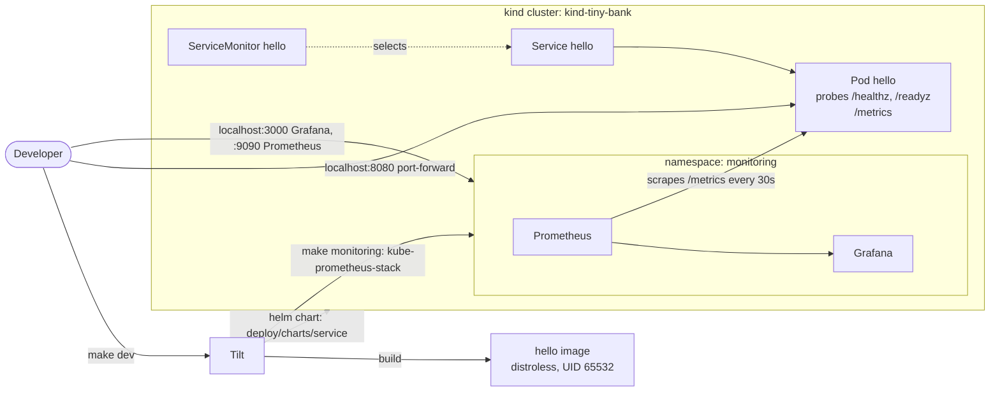

# Architecture

This page grows with the project. The **target** shows where we're heading. **Current** shows what actually exists today.

## Target

- **Runtime:** Docker on Kubernetes (kind locally). Services are deployed with one generic Helm chart, and Tilt runs the dev loop.
- **Data:** one Postgres database per service, managed by CloudNativePG. Services never read another service's database.
- **Events:** services publish through a transactional outbox to Kafka (Strimzi). Consumers deduplicate with an inbox table.
- **Money:** `int64` minor units plus a currency code. Never floats.

## Current

One demo service, `hello`, plus the monitoring stack, running on a local kind cluster:

- **Image:** one shared `Dockerfile`, multi-stage, distroless and non-root.
- **Cluster:** one-node kind cluster (`make cluster-up`).
- **Deploy:** one shared Helm chart plus `deploy/values/hello.yaml`. The chart also creates a `ServiceMonitor`, so Prometheus scrapes every service.
- **Dev loop:** Tilt rebuilds and redeploys on save.
- **Monitoring:** kube-prometheus-stack (Prometheus Operator, Prometheus, Grafana, kube-state-metrics) in the `monitoring` namespace, installed by `make monitoring`. See [observability.md](observability.md).

See [ADR-0002](adr/0002-run-everything-in-docker-on-kubernetes.md) for why we run on Kubernetes, [ADR-0003](adr/0003-measure-services-with-prometheus-red-metrics.md) for how we measure services, and [deploy/AGENTS.md](../deploy/AGENTS.md) for the rules.
