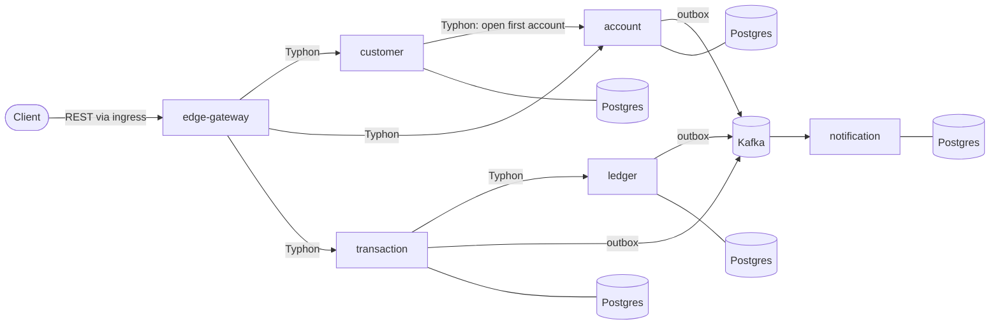
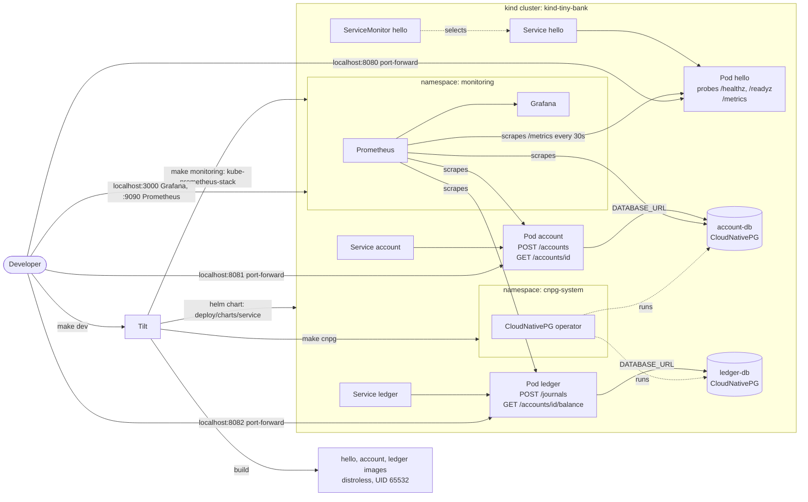

# Architecture

This page grows with the project. The **target** shows where we're heading. **Current** shows what actually exists today.

## Target

- **Services:** Go, built on [Typhon](https://github.com/monzo/typhon), an RPC framework that wraps `net/http`, with errors as [terrors](https://github.com/monzo/terrors). Each service's API is a protobuf contract in `proto/`, checked by `buf` for breaking changes, and services call each other over HTTP ([ADR-0007](adr/0007-build-services-on-typhon-and-terrors.md)).
- **Runtime:** Docker on Kubernetes (kind locally). Services are deployed with one generic Helm chart, and Tilt runs the dev loop.
- **Data:** one Postgres database per service, managed by CloudNativePG. Services never read another service's database.
- **Events:** services publish through a transactional outbox to Kafka (Strimzi). Consumers deduplicate with an inbox table.
- **Money:** `int64` minor units plus a currency code. Never floats.
- **Customers before accounts:** the customer service onboards a person (identity checks, terms) and creates their customer ID, then opens their first account. The account service never creates customers. Once someone is signed in, the edge gateway takes their customer ID from the sign-in token; customers never send it themselves ([ADR-0006](adr/0006-onboard-customers-before-accounts.md)).

## Current

Three services, `hello`, `account` and `ledger` (each of the last two with its own Postgres), plus the monitoring stack and the Postgres operator, running on a local kind cluster:

- **Image:** one shared `Dockerfile`, multi-stage, distroless and non-root.
- **Cluster:** one-node kind cluster (`make cluster-up`).
- **Deploy:** one shared Helm chart plus a small values file per service (`deploy/values/hello.yaml`, `account.yaml`, `ledger.yaml`). The chart also creates a `ServiceMonitor`, so Prometheus scrapes every service.
- **Dev loop:** Tilt rebuilds and redeploys on save.
- **Monitoring:** kube-prometheus-stack (Prometheus Operator, Prometheus, Grafana, kube-state-metrics) in the `monitoring` namespace, installed by `make monitoring`. See [observability.md](observability.md).
- **Postgres:** the [CloudNativePG](https://cloudnative-pg.io) operator in `cnpg-system`, installed by `make cnpg`. It turns each `Cluster` object into a running Postgres, with its users, passwords, storage and failover. A service turns on `database.enabled` in its values file, and the shared chart gives it its own Postgres `Cluster` (`<name>-db`), with its connection string passed in as `DATABASE_URL`.
- **Account service:** `cmd/account` plus `services/account`. It connects to `account-db` and applies its migrations before serving, and offers `POST /accounts` and `GET /accounts/:id` on Typhon, as JSON following its contract, `proto/account/v1`. It's internal only (ClusterIP, no sign-in) until the edge gateway.
- **Ledger service:** `cmd/ledger` plus `services/ledger`, with its own `ledger-db`. It records every movement of money as a double-entry journal whose entries add up to zero, locking the accounts it touches so balances can't race, and takes an idempotency key so a retried request moves money once. It offers `POST /journals`, `GET /journals/:id` and `GET /accounts/:id/balance`, following `proto/ledger/v1`. Internal only, like the account service.

See [ADR-0002](adr/0002-run-everything-in-docker-on-kubernetes.md) for why we run on Kubernetes, [ADR-0003](adr/0003-measure-services-with-prometheus-red-metrics.md) for how we measure services, and [deploy/AGENTS.md](../deploy/AGENTS.md) for the rules.
