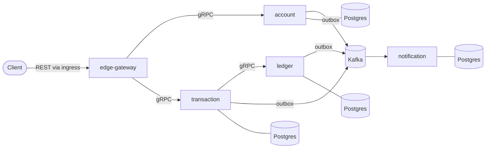

# Architecture

This page grows with the project. The **target** shows where we're heading. **Current** shows what actually exists today.

## Target

- **Runtime:** Docker on Kubernetes (kind locally). Services are deployed with one generic Helm chart, and Tilt runs the dev loop.
- **Data:** one Postgres database per service, managed by CloudNativePG. Services never read another service's database.
- **Events:** services publish through a transactional outbox to Kafka (Strimzi). Consumers deduplicate with an inbox table.
- **Money:** `int64` minor units plus a currency code. Never floats.

## Current

Nothing runs yet. Phase 0 sets up the repo, conventions and CI.
