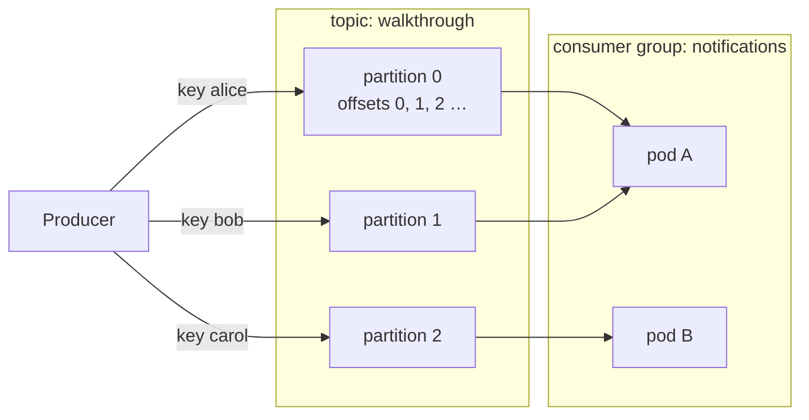

# Phase 9 — Kafka via Strimzi

## What we built

- **The Strimzi operator** ([deploy/strimzi/values.yaml](../../deploy/strimzi/values.yaml), `make strimzi`): it turns a `Kafka` object into running brokers, with their storage and config, as CloudNativePG does for Postgres. Its pods use the restricted pod-security profile, like ours.
- **A Kafka cluster, `tiny-bank`** ([deploy/kafka/kafka.yaml](../../deploy/kafka/kafka.yaml), `make kafka`): Kafka 4.3 in KRaft mode, one node that is both broker and controller, on a 1 GiB volume, with its disk use bounded to fit. It has one plaintext listener, reached only inside the cluster at `tiny-bank-kafka-bootstrap.kafka:9092`.
- **Topics declared in git** ([deploy/kafka/topics.yaml](../../deploy/kafka/topics.yaml)): each topic is a `KafkaTopic` object, and Kafka won't create one just because a client writes to it. There's one for now, `walkthrough`, for trying Kafka out by hand. `make chart-check` validates these files against Strimzi's schemas, so CI checks them too.
- **`pkg/kafka`** ([kafka.go](../../pkg/kafka/kafka.go)), the one place services touch Kafka, on [franz-go](https://github.com/twmb/franz-go). The choice, and the alternatives, are in [ADR-0012](../adr/0012-send-events-on-kafka-with-franz-go.md).
  - `Producer.Produce` returns only once Kafka has stored the message, and the producer is idempotent, so franz-go's own retries never write a message twice.
  - `Consume` joins a consumer group and gives each partition a worker of its own. A message is committed only after its handler succeeds, and a failure is retried every second, holding only its own partition.
  - The trace travels in each message as a `traceparent` header: a `send <topic>` span on the way in, and a `process <topic>` span around the handler.
  - `KAFKA_BROKERS` says where Kafka is, and a service that uses Kafka refuses to start without it.
  - Tests run against kfake, franz-go's in-memory Kafka, so they need no Docker.

**What waits for later.** No service sends or receives messages yet. The transaction service starts sending in Phase 10, through a transactional outbox, so a message is sent if and only if its transfer was saved. The first consumer, the notification service, comes in Phase 11, with an inbox table to skip messages it has already handled, and the consumer lag metric. Kafka has no authentication, TLS or topic ACLs yet: that's a known gap in [docs/security.md](../security.md), for hardening (a user per service, TLS and topic ACLs).

## Concepts



- **A topic is a log, not a queue.** Messages are appended and kept (here, for a day, or until the topic reaches its size limit), and reading one doesn't remove it. Many readers can read the same topic, each at its own pace, and one can go back and read it again.
- **Partitions are how a topic scales.** A topic is split into partitions, each its own log, with messages numbered by **offset** (0, 1, 2 …). Order is kept within a partition, never across the topic.
- **A key keeps related messages in order.** A message's key decides its partition (a hash of the key), so every message about one account, keyed by its ID, lands on one partition, in the order it was sent. Messages without a key are spread out, with no order between them.
- **A consumer group shares the work.** Every pod that reads with the same group name gets some of the partitions, and each partition goes to exactly one pod in the group. More pods means more spread, up to one pod per partition. A different group reads the whole topic again, separately: the notification service and, later, an analytics service each see every message.
- **Rebalancing moves partitions between pods.** When a pod joins, leaves or stops answering, Kafka moves partitions to the others. `Consume` stops a partition's worker, and commits what it handled, before the partition moves, so two pods don't handle it at once. That only holds for an orderly handoff. A pod that loses contact with Kafka has its partitions given away when its session expires, possibly while a handler is still running, so handlers must be safe to run twice.
- **Offsets and at-least-once.** A group remembers, per partition, the offset to read from next: its **committed offset**. Commit before handling and a crash skips a message. Commit after, as `Consume` does, and a crash means it's handled again. Losing an event about money is worse than seeing it twice, so tiny-bank takes at-least-once, and consumers skip what they've already seen. **Lag** is how far a group is behind: the newest offset minus the committed one.
- **A failing message holds its partition.** Skipping it would break that account's order, and could lose it. So it's retried until it succeeds, and the messages behind it on its partition wait, while the other partitions carry on. That shows up as lag on one partition, and as failed `process` spans.
- **KRaft, not ZooKeeper.** Kafka used to need a second system, ZooKeeper, to keep track of which broker leads which partition. Since Kafka 4.0 it keeps that itself, in its own Raft log, on nodes with the controller role. Here one node is broker and controller at once. In production they'd be separate, with three or more of each.
- **Why an operator.** Running Kafka means a StatefulSet, volumes, config, certificates and rolling restarts in the right order. Strimzi does that from a short `Kafka` object, and the topic operator keeps topics in step with the `KafkaTopic` objects in git.

## How to verify

```bash
make check
```

```bash
make chart-check
```

With `make dev` running, the Kafka cluster and its topic should be ready:

```bash
kubectl --context kind-tiny-bank -n kafka get kafka,kafkatopic
```

Send some keyed messages with Kafka's own command-line tools, which are in the broker's pod. Each line is `key:value`:

```bash
printf 'alice:deposited 10\nbob:deposited 5\nalice:sent 3 to bob\ncarol:deposited 20\nbob:sent 1 to carol\n' | kubectl --context kind-tiny-bank -n kafka exec -i tiny-bank-dual-role-0 -- bin/kafka-console-producer.sh --bootstrap-server localhost:9092 --topic walkthrough --reader-property parse.key=true --reader-property key.separator=:
```

Read them as a consumer group, `walkthrough-readers`. It stops after 8 seconds without a new message:

```bash
kubectl --context kind-tiny-bank -n kafka exec tiny-bank-dual-role-0 -- bin/kafka-console-consumer.sh --bootstrap-server localhost:9092 --topic walkthrough --group walkthrough-readers --from-beginning --timeout-ms 8000 --formatter-property print.key=true --formatter-property print.partition=true --formatter-property print.offset=true
```

Every message for one key is on one partition, in the order it was sent, and the offsets count up within each partition, not across them. Ignore the `TimeoutException` at the end: it's how the tool says it waited 8 seconds with nothing new.

The group has committed how far it read, so its lag is 0 on every partition:

```bash
kubectl --context kind-tiny-bank -n kafka exec tiny-bank-dual-role-0 -- bin/kafka-consumer-groups.sh --bootstrap-server localhost:9092 --describe --group walkthrough-readers
```

Send one more message, and describe the group again: its partition now has a lag of 1.

```bash
printf 'dave:deposited 7\n' | kubectl --context kind-tiny-bank -n kafka exec -i tiny-bank-dual-role-0 -- bin/kafka-console-producer.sh --bootstrap-server localhost:9092 --topic walkthrough --reader-property parse.key=true --reader-property key.separator=:
```

Read as the group again, this time without `--from-beginning`. It carries on from its committed offset, so it prints only Dave's message. A new group name would read everything again.

```bash
kubectl --context kind-tiny-bank -n kafka exec tiny-bank-dual-role-0 -- bin/kafka-console-consumer.sh --bootstrap-server localhost:9092 --topic walkthrough --group walkthrough-readers --timeout-ms 8000 --formatter-property print.key=true --formatter-property print.partition=true
```

A topic that isn't declared in git doesn't exist, and writing to it doesn't create it. The producer warns `UNKNOWN_TOPIC_OR_PARTITION` and gives up after 5 seconds:

```bash
printf 'x\n' | kubectl --context kind-tiny-bank -n kafka exec -i tiny-bank-dual-role-0 -- bin/kafka-console-producer.sh --bootstrap-server localhost:9092 --topic made-up-topic --command-property max.block.ms=5000
```

To see `pkg/kafka` do the same things, run its tests: one key on one partition, a group sharing partitions and handing one over while it's retrying, a failure holding only its own partition, what's handled committed as a pod stops, and the trace carried from producer to handler.

```bash
go test -race -count=1 -v ./pkg/kafka/
```
