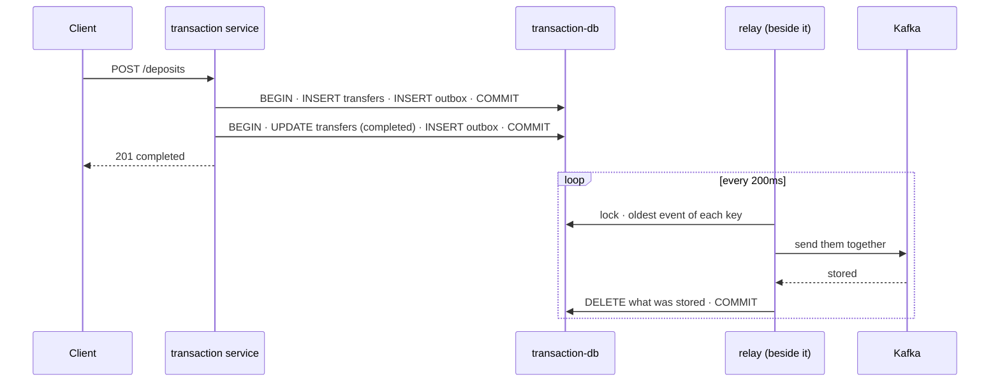

# Phase 10 — Transactional outbox

## What we built

- **An event contract, `TransferChanged`** ([events.proto](../../proto/transaction/v1/events.proto)): the transfer as it was just after a change, with an `event_id` and the time of the change. It's sent when a transfer is created (pending), and again when it's completed or failed. The caller's `idempotency_key` is left out, as it's their own text.
- **`pkg/outbox`** ([outbox.go](../../pkg/outbox/outbox.go)), the shared transactional outbox. The design and the alternatives are in [ADR-0013](../adr/0013-announce-changes-through-a-transactional-outbox.md).
  - `Add` saves an event, as binary protobuf with its trace, in the caller's transaction.
  - `Relay` sends what's saved to Kafka: one pod at a time (an advisory lock), the oldest event of each key per batch, all together (`Producer.ProduceAll` in `pkg/kafka`), deleting each once Kafka has stored it. Each batch's sends have a 10-second limit, and failures back off up to 5 seconds.
  - Backlog metrics: events waiting, the oldest one's age, and events sent.
- **A topic, `transaction.transfers`** ([topics.yaml](../../deploy/kafka/topics.yaml)): three partitions, a week's retention, and a disk budget of 240 MiB.
- **The transaction service announces every change** ([events.go](../../services/transaction/events.go), [store.go](../../services/transaction/store.go)). `Create`, `Complete` and `Fail` announce inside the transaction that makes the change; a retry or a repeated answer announces nothing. Its relay runs beside the finisher, and it needs `KAFKA_BROKERS` to start.
- **Kafka UI** ([values.yaml](../../deploy/kafka-ui/values.yaml), `make kafka-ui`, localhost:8085): browse topics, consumer groups and messages, decoded from `proto/`. It's read-only and local only.
- **Outbox panels on the transaction dashboard:** events waiting, the oldest waiting, events sent per second, and waiting against sent over time.

**What waits for later.** Nothing reads the events yet. The notification service, in Phase 11, is the first consumer, with an inbox table to skip an `event_id` it has already handled, and the consumer lag metric. Alert rules on the backlog come with the other alerts in Phase 13, as do Kafka's authentication, TLS and topic ACLs.

## Concepts



- **The dual-write problem.** A change saved in Postgres and its event sent to Kafka are two writes to two systems, and nothing makes them atomic. Save then send, and a crash in between loses the event; send then save, and a rollback announces something that never happened. Either way the other services' view drifts from the truth, quietly.
- **A transactional outbox.** Instead of sending the event, the service saves it: a row in an `outbox` table in its own database, in the same transaction as the change. Postgres makes those two writes atomic, so the event exists if and only if the change does. A relay then reads the table and sends what's there, like a dispatch slip written on the same carbon pad as the receipt and collected by a courier later.
- **At least once, so every event has an ID.** The relay deletes an event only after Kafka has stored it, in a transaction that can fail after the send. Then the event is sent again: never lost, sometimes twice. So each event carries an `event_id`, and a consumer remembers which it has handled (an inbox) and skips a repeat. That makes handling an event once only if the consumer saves its work and the event's ID in the same transaction of its own database: save the ID first and a crash loses the work, save it after and a crash repeats it. Anything it does outside that database, like sending a push notification, can still happen twice, so it needs its own protection, such as an idempotency key of its own, or must be harmless to repeat.
- **Order per key, not overall.** What has to hold is that one transfer's pending event arrives before its completed one; events about different transfers have no order that means anything. So events are keyed by transfer ID (one key, one partition, in order), and each batch sends only the oldest waiting event of each key. If one is stuck, only its key waits. Insert order is commit order only for transactions that don't overlap, so one transfer's changes must never overlap. They don't: each change locks the transfer's row, so two calls finishing it take turns, and the second changes nothing.
- **One sender at a time.** If every pod sent events, two could send one transfer's events in the wrong order. A Postgres advisory lock held for each batch lets only one pod send at a time; the others try again a moment later, and take over if that pod stops.
- **Events are news, not the record.** The outbox is emptied as events go, and Kafka keeps them for a week. The record of what happened is the transfers table and the ledger's journals, which is what a regulator relies on. Events tell other services so they can react.
- **The backlog is the health check.** Normally nothing waits for more than a moment. If Kafka is down or refusing events, `outbox_waiting_events` grows and `outbox_oldest_waiting_seconds` climbs, while money keeps moving. That's the outbox doing its job, and the dashboard shows it.

## How to verify

```bash
make check
```

```bash
make test-integration
```

This needs Docker. `pkg/outbox`'s tests run against Postgres and an in-memory Kafka: order per key, one relay at a time, a stuck event holding back only its key, giving up when Kafka is gone. The transaction service's tests check that only real changes announce, that a failed announcement saves nothing, and, end to end with the ledger and account service, that a deposit and a refused transfer reach Kafka as pending then completed or failed, with the request's trace.

With `make dev` running, open an account and make a deposit:

```bash
ALICE=$(curl -s -X POST localhost:8081/accounts -H 'Content-Type: application/json' -d '{"customer_id":"c0ffee00-0000-4000-8000-000000000001","holder_name":"Alice","currency":"GBP"}' | jq -r .id); echo $ALICE
```

```bash
DEPOSIT=$(curl -s -X POST localhost:8083/deposits -H 'Content-Type: application/json' -d "{\"idempotency_key\":\"walkthrough-$ALICE\",\"account_id\":\"$ALICE\",\"currency\":\"GBP\",\"amount\":1000}" | jq -r .id); echo $DEPOSIT
```

Open Kafka UI at [localhost:8085](http://localhost:8085), then Topics, `transaction.transfers`, Messages. The deposit is two messages with its ID as their key: `TRANSFER_STATE_PENDING`, then `TRANSFER_STATE_COMPLETED`, each with its own `eventId`, and an empty `idempotencyKey`.

Find the deposit's trace. The transfer saved the trace ID of the request that created it:

```bash
kubectl --context kind-tiny-bank exec transaction-db-1 -c postgres -- psql app -tAc "SELECT trace_id FROM transfers WHERE id = '$DEPOSIT'"
```

Open it in Jaeger at `localhost:16686/trace/<trace_id>`. Under `POST /deposits` are the two `INSERT outbox` queries, inside the transactions that saved the changes, and two `send transaction.transfers` spans from the relay, sent a moment after the request finished but in the same trace.

Now make Kafka unavailable for a while: delete its broker's pod. Strimzi starts a new one on the same volume, so no message is lost, but it takes a few seconds.

```bash
kubectl --context kind-tiny-bank -n kafka delete pod tiny-bank-dual-role-0 --wait=false
```

Straight away, make three deposits. They complete at once (201): moving money doesn't wait on Kafka.

```bash
for i in 1 2 3; do curl -s -o /dev/null -w "%{http_code} " -X POST localhost:8083/deposits -H 'Content-Type: application/json' -d "{\"idempotency_key\":\"outage-$ALICE-$i\",\"account_id\":\"$ALICE\",\"currency\":\"GBP\",\"amount\":100}"; done; echo
```

Their events wait in the outbox:

```bash
curl -s localhost:8083/metrics | grep -E '^outbox_(waiting_events|oldest_waiting_seconds)'
```

`outbox_waiting_events` is 6 (two per deposit), and the oldest has waited a few seconds. Run it again once the broker is back (`kubectl --context kind-tiny-bank -n kafka get pod tiny-bank-dual-role-0`, usually within 15 seconds): both are 0, and the six events are on the topic in Kafka UI, each deposit's pending before its completed. On [tiny-bank / Transactions](http://localhost:3000/d/tiny-bank-transaction), the outbox panels show it as a blip in "Events waiting to send" and a burst in "Outbox over time"; Prometheus scrapes every 30 seconds, so a short outage may show as a single point.
