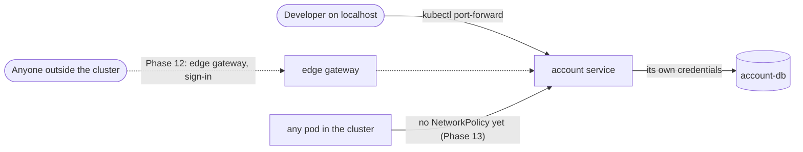

# Security

What tiny-bank protects, where its trust boundaries are, which controls are in place and what each one stops, and the gaps that are still open. The rules every change must follow are in the root [AGENTS.md](../AGENTS.md#security), including keeping this page true: a change that touches a control, a gap or a file they link to updates its row in the same PR. To report a vulnerability, see [SECURITY.md](../SECURITY.md).

## What we protect

| Asset | Why it matters |
|---|---|
| **Money** | A balance must never be wrong. Amounts are `int64` minor units, never floats ([ADR-0004](adr/0004-represent-money-as-int64-minor-units.md)); the ledger, from Phase 7, is the record of every movement. |
| **Personal data** | Holder names and customer IDs identify real people. They stay in the owning service's database, and out of side channels such as metric labels, error messages and terror params. |
| **Secrets** | `DATABASE_URL` holds a database password. Leaking it gives full access to that service's data. |
| **Availability** | One bad request, or one misbehaving caller, mustn't take a service down for everyone. |

## Trust boundaries

- **Outside the cluster → a service:** nothing crosses this today. Every service is a `ClusterIP` Service with no Ingress. The only way in is `kubectl port-forward`, which listens on localhost. In Phase 12 the edge gateway becomes the one way in, and checks who the caller is.
- **Pod → service, inside the cluster:** trusted completely today. Any pod can call any service, and the account API believes whatever customer ID a caller sends ([ADR-0006](adr/0006-onboard-customers-before-accounts.md)). This is the biggest gap, and why nothing may be exposed before Phase 12.
- **Service → its database:** each service has its own Postgres and its own generated credentials, and only that service's pods get them. No service reads another's database.
- **Service → caller (errors):** callers, including other services, see a terror's code, message and params, and nothing else.

## Controls in place

| Control | Stops | Where |
|---|---|---|
| Services are `ClusterIP` only, with no Ingress | Anyone outside the cluster reaching an API that has no sign-in | [service.yaml](../deploy/charts/service/templates/service.yaml) |
| `kit.Decode` is strict: `Content-Type: application/json`, one object, no unknown fields | A browser posting cross-site as a "simple" request; typos silently ignored; surprising shapes such as `null` | [decode.go](../pkg/kit/decode.go) |
| Every body capped at 16 KB with `http.MaxBytesReader`, which also closes the connection | Tying up memory or bandwidth with a huge body | [handler.go](../pkg/kit/handler.go) |
| Caller input parsed into typed values at the edge; only canonical UUIDs accepted | Malformed values reaching storage; one account reachable under many URLs | [http.go](../services/account/http.go) |
| Every query passes values as parameters | SQL injection | [store.go](../services/account/store.go) |
| Database `CHECK` constraints repeat the key rules | Bad data, even if the code ever let it through | [migrations](../services/account/migrations/) |
| Error cleaning: only a terror's code, message and params leave a service | Stack traces, file paths and raw database errors reaching callers | [handler.go](../pkg/kit/handler.go), `cleanErrors` |
| Full errors logged with the request ID | Failures nobody can explain afterwards | [handler.go](../pkg/kit/handler.go) |
| `kit.Secret` prints as `xxxxx` in `fmt`, `slog`, errors and JSON | A secret leaking because someone logged a config | [secret.go](../pkg/kit/secret.go), [ADR-0008](adr/0008-stop-secrets-where-they-enter.md) |
| Caller request IDs reused only if short and plain (`A-Z a-z 0-9 - _`, at most 64) | Fake log lines injected through a header | [requestid.go](../pkg/kit/requestid.go) |
| Metric labels use route patterns and a fixed set of methods | Account IDs in metrics, and callers creating unlimited time series | [handler.go](../pkg/kit/handler.go), [metrics.go](../pkg/obs/metrics.go) |
| Panics recovered per request | One bad request crashing the service | [handler.go](../pkg/kit/handler.go) |
| One database per service, with credentials generated by CloudNativePG | One service, or a bug in it, reading another's data | [database.yaml](../deploy/charts/service/templates/database.yaml) |
| Pods run as a non-root UID, with a read-only filesystem, no privilege escalation, all capabilities dropped, the default seccomp profile and no Kubernetes API token | An attacker who gets code running in a pod getting any further | [deployment.yaml](../deploy/charts/service/templates/deployment.yaml) |
| Distroless images with no shell or package manager | Tools an attacker could use inside a container | [Dockerfile](../Dockerfile) |
| Dependencies pinned in `go.mod`; `golang.org/x/net` held at a current version over Typhon's old one | Silently picking up a changed dependency; missing HTTP/2 security fixes | [go.mod](../go.mod), [ADR-0007](adr/0007-build-services-on-typhon-and-terrors.md) |
| Every check runs in CI on every PR, and branch names are checked before push | A change merged without its tests, lint or contract checks | [ci.yml](../.github/workflows/ci.yml) |

## Known gaps

Each gap is known and has a plan. A change must not make one worse in the meantime.

| Gap | Risk today | Closed by |
|---|---|---|
| No sign-in: the account API trusts the customer ID a caller sends | Any pod in the cluster can open or read accounts for anyone | Phase 12: edge gateway, with the customer ID taken from the sign-in token |
| No NetworkPolicies: any pod can call any service | A compromised pod can reach every service | Phase 13: hardening |
| No rate limits | One caller can use up a service's capacity | Phase 13: hardening |
| Money doesn't move yet, so nothing is idempotent or audited | None yet | Phase 7: the ledger, with idempotency keys and an audit trail |
| A revealed secret is an ordinary string again | Code that puts the value from `Reveal()`, or `string(s)`, into an error or log leaks it | Review: each `Reveal()` call is checked ([ADR-0008](adr/0008-stop-secrets-where-they-enter.md)) |
| No TLS between services, or to Postgres | Traffic inside the local cluster is readable by anything on it | Not planned for the local cluster |
| No automated check for known-vulnerable dependencies (such as `govulncheck`) | A vulnerable dependency could go unnoticed | Not planned yet |
| Local Grafana lets anyone in as admin | Anyone with access to the developer's machine can change dashboards | Local only, by design: reachable only through `kubectl port-forward` |
